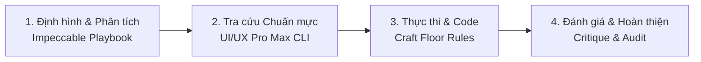

# AGENTS.md - Quy chuẩn làm việc cho Agent (Novel Writing Application)

Tài liệu này là quy chuẩn bắt buộc agent phải đọc và tuân thủ trước khi thực hiện bất kỳ tác vụ nào (lập kế hoạch, thiết kế UI/UX, viết code, review hoặc refactor) trong dự án **Novel Writing Application**.

Dự án tích hợp sức mạnh từ hai bộ kỹ năng thiết kế cốt lõi:
1. **Impeccable** (`.agent/skills/impeccable`): Định hình quy trình chế tác giao diện đỉnh cao (*Out-of-Distribution Craft*), kỷ luật thiết kế, đánh giá heuristic và nguyên tắc chất lượng nghiêm ngặt.
2. **UI/UX Pro Max** (`.agent/skills/ui-ux-pro-max`): Hệ thống dữ liệu trí tuệ thiết kế (80 styles, 192 product profiles, 74 font pairings, 120 UX guidelines, tra cứu stack Tailwind/React/Tauri).

---

## 1. Nguyên Tắc & Tinh Thần Sản Phẩm (Product Truth)

Luôn đối chiếu với [PRODUCT.md](file:///c:/Study/novel-writing-application/PRODUCT.md) trước khi đưa ra quyết định:
- **Platform & Stack**: Desktop Native trải nghiệm Web hiện đại (**Tauri + React + TypeScript + Tailwind CSS**).
- **Mục tiêu tối thượng**: Không gian viết tập trung cao độ (**Distraction-free / Zen mode**) kết hợp hệ thống dữ liệu bối cảnh dễ dàng tra cứu (Nhân vật, Dàn ý chương hồi, World-building Bible).
- **Phong cách cốt lõi**: *Minimalism & Swiss Modernism / Soft Paper UI* — Màu giấy ấm (cream/warm paper tone), mực trầm dịu mắt cho tác giả viết đêm, typography chuẩn mực, loại bỏ hoàn toàn các yếu tố visual gây phân tâm.

---

## 2. Quy Trình Phối Hợp 2 Skill (Dual-Skill Workflow)

Khi triển khai bất kỳ tính năng UI/UX nào, tuân thủ luồng 4 bước sau:



### Bước 1: Định hình & Phân tích (Impeccable Phase)
- Xác định **Mode** của màn hình/tính năng theo Impeccable:
  - **Operate**: Trình soạn thảo văn bản, trang quản lý timeline, bảng quản lý nhân vật, settings (Ưu tiên: Tốc độ quét mắt, phím tắt keyboard-driven, độ ổn định).
  - **Read**: Chế độ đọc duyệt lại bản thảo, tra cứu hồ sơ thế giới (Ưu tiên: Nhịp điệu đọc, độ thoáng typography).
- Sử dụng quy trình `shape` trước khi bắt đầu code một module phức tạp.

### Bước 2: Tra cứu Chuẩn mực Thiết kế (UI/UX Pro Max Query)
Trước khi chọn màu sắc, typography hoặc layout, chạy script tìm kiếm thông số chuẩn:
```bash
# Tra cứu palette, style phù hợp với app viết lách
python .agent/skills/ui-ux-pro-max/scripts/search.py "notes editor" --domain product

# Tra cứu cặp font phù hợp cho đọc/viết dài
python .agent/skills/ui-ux-pro-max/scripts/search.py "editorial book serif" --domain typography

# Tra cứu hướng dẫn UX cho rich text editor & desktop navigation
python .agent/skills/ui-ux-pro-max/scripts/search.py "editor" --domain ux
```

### Bước 3: Tiêu Chuẩn Thực Thi (Craft Floor - Impeccable & UI/UX Pro Max)
Khi viết mã CSS/Tailwind và React Component:
1. **Typography & Spacing**:
   - Khoảng cách dòng (`line-height`) cho nội dung viết chính phải từ `1.6 - 1.8` để đảm bảo độ thoải mái khi đọc lâu.
   - Sử dụng font Serif trang nhã hoặc Sans-serif trung tính chuyên biệt cho việc đọc (VD: *Merriweather, Lora, Newsreader, Inter*).
   - Hệ thống khoảng cách tuân thủ lưới 4px / 8px.
2. **Màu sắc & Chế độ xem**:
   - Sử dụng CSS Variables / Tailwind Semantic Tokens (vd: `--bg-canvas`, `--bg-surface`, `--text-ink-primary`, `--accent-amber`).
   - Cấm hardcode mã hex trực tiếp rải rác trong JSX component.
   - Bắt buộc hỗ trợ Dark / Light / Sepia (Warm Paper) Mode với độ tương phản WCAG AA (tối thiểu 4.5:1).
3. **Tương tác Desktop & Accessibility**:
   - Hỗ trợ đầy đủ phím tắt bàn phím (Ctrl/Cmd + S, Ctrl/Cmd + F, phím tắt định dạng).
   - Không được bỏ visual focus indicators (viền focus khi dùng bàn phím).
   - Vùng bấm tối thiểu 40-44px; phản hồi tương tác mượt mà (transition 150ms-250ms, không dùng giật cục 0ms).
   - Không dùng emoji thay thế icon hệ thống; sử dụng SVG icons đồng bộ (Phosphor / Lucide Icons).

### Bước 4: Đánh giá & Rà soát (Evaluation Phase)
- Đánh giá heuristic theo checklist của Impeccable (`critique` / `audit`).
- Kiểm tra tính chống chịu layout: Không để tràn thanh cuộn ngang ngoài ý muốn, trạng thái rỗng (empty state) khi chưa có chương/nhân vật nào phải có thông điệp hướng dẫn rõ ràng.

---

## 3. Quy Định Làm Việc (Agent Guardrails)

1. **Không code ẩu / Không "placeholder hóa"**: Code sản xuất phải hoàn chỉnh, xử lý đầy đủ các trạng thái `loading`, `empty`, `error` và `saving`.
2. **Bảo toàn dữ liệu tác giả**: Ưu tiên cơ chế Auto-save (debounce) và lưu trữ cục bộ, không bao giờ để mất chữ khi người dùng thao tác.
3. **Cập nhật tài liệu**: Khi có thay đổi về kiến trúc UI hoặc thiết lập token mới, cập nhật vào tài liệu hệ thống hoặc `DESIGN.md`.

